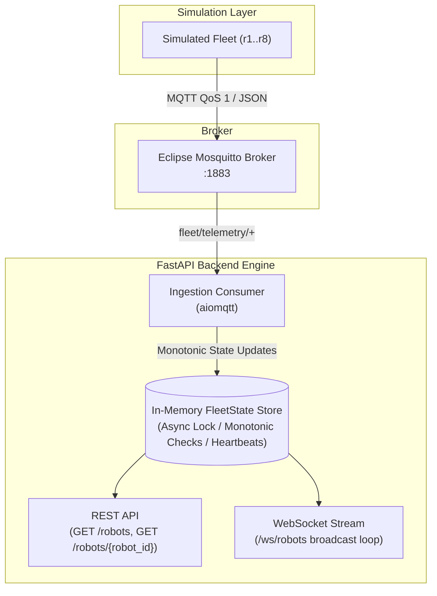

# Real-Time Fleet Telemetry Backend

[](https://github.com/Aaron-joyce/fleet-telemetry-backend/actions/workflows/ci.yml)

This is the backend track of a hiring challenge. It listens to live telemetry from a simulated robot fleet over MQTT, keeps the current state of every robot in memory, and serves that state over both a REST API and a WebSocket stream. Built with FastAPI, `aiomqtt`, and Docker.

---

## How It Works



### A few things worth calling out

- **Coroutine-safe state store:** The in-memory fleet state uses `asyncio.Lock` with copy-on-read. All reads and writes acquire the same lock, which guarantees consistency across concurrent coroutines on one event loop. Callers receive a copy of internal state so they can't accidentally mutate it.
- **Out-of-order protection:** If a telemetry frame arrives with a timestamp older than or equal to what's already stored, it gets dropped. This keeps the state consistent even when the network reorders packets.
- **Offline robot detection:** A background task checks every second and marks any robot that hasn't sent a heartbeat in more than 5 seconds as `offline`. This uses `time.monotonic()` so it's immune to system clock adjustments.
- **Reconnect logic:** If the MQTT broker goes away, the consumer retries with full-jitter exponential backoff — each delay is chosen uniformly at random between 0 and the computed ceiling (1 s, 2 s, 4 s … capped at 30 s), so multiple instances don't reconnect in a thundering herd — rather than hammering the broker or crashing.
- **Failure-handling test coverage:** The test suite exercises broker outage recovery (stale marking is suppressed while disconnected and during the reconnect grace window), session-id reboot recovery (a new session resets the timestamp baseline), and the full backoff sequence (caps verified as `[1, 2, 4, 8, 16, 30, 30]` seconds), alongside eviction boundary cases.

---

## Tech Stack

| Layer | Choice |
|---|---|
| Language | Python 3.13 |
| Package manager | `uv` |
| API framework | FastAPI + Uvicorn + Starlette WebSockets |
| MQTT client | `aiomqtt` (async) |
| Message broker | Eclipse Mosquitto |
| Testing | `pytest`, `pytest-asyncio`, `pytest-cov`, `httpx` |
| Orchestration | Docker Compose |

---

## Getting Started

**You only need Docker.** Everything else runs inside containers.

### Run the whole stack

This starts the Mosquitto broker, the FastAPI backend, and the 8-robot simulation — all in one go:

```bash
docker compose up --build -d
```

Check what's running:

```bash
docker compose ps
```

Tail the backend logs:

```bash
docker compose logs -f backend
```

---

## API

### REST

#### List all robots

```bash
curl -s http://localhost:8000/robots | jq
```

**Response (200 OK):**

```json
[
  {
    "robot_id": "r1",
    "x": 525.0,
    "y": 5.0,
    "battery": 55.8,
    "status": "idle",
    "t": 580.0,
    "seconds_since_last_seen": 0.34
  }
]
```

#### Get a single robot

```bash
curl -s http://localhost:8000/robots/r1 | jq
```

#### Unknown robot ID

```bash
curl -s -i http://localhost:8000/robots/r99 | grep "404 Not Found"
```

### WebSocket

Connect to `ws://localhost:8000/ws/robots` and you'll receive a full fleet snapshot as a JSON array every 500ms.

```bash
uv run python -c "
import asyncio, websockets, json

async def stream():
    async with websockets.connect('ws://localhost:8000/ws/robots') as ws:
        for _ in range(3):
            data = await ws.recv()
            fleet = json.loads(data)
            print(f'Received broadcast frame with {len(fleet)} robots')

asyncio.run(stream())
"
```

---

## Local Development & Tests

```bash
# Clone and install
git clone https://github.com/Aaron-joyce/fleet-telemetry-backend.git
cd fleet-telemetry-backend
uv sync
```

The test suite covers 100% of the `app/` codebase:

```bash
uv run pytest --cov=app --cov-report=term-missing --cov-branch
```

> **Note:** Branch coverage is configured as the default in `pyproject.toml`.

---

## Known Limitations

The following are deliberate simplifications appropriate for the current scope.
They become load-bearing if the system grows.

### State is in-process and non-persistent
All robot state lives in `FleetState._robots` — a plain Python dict inside
the FastAPI process. If the backend restarts or crashes, the entire state is
lost. Robots are re-populated from `data/robots.json` defaults and must
re-publish to restore their last known position.

**Scale implication:** there is no shared state store (Redis, Postgres, etc.),
so running more than one backend instance would give each instance an
independent, divergent view of the fleet. Horizontal scaling requires
externalising state first.

### Single broker is a single point of failure
Mosquitto runs as a single container with no clustering or persistence
configured. If it restarts, all in-flight QoS 1 messages in transit are lost
(the broker's session state is not persisted to disk in the current
`mosquitto.conf`). The backend reconnects automatically, but messages
published during the outage are gone.

### Clock-reset / robot reboot vulnerability
The out-of-order guard compares the device-supplied `t` field. A robot that
reboots and resets its timestamp counter previously had all subsequent frames
silently rejected until `t` overtook the stored value. With Spec 01 merged,
this is handled via `session_id` tracking (a new session resets the timestamp
baseline). However, within a single session, any backward clock adjustment
still causes frames to be dropped as out-of-order.

### No authentication or authorisation
The MQTT broker accepts anonymous connections on port 1883. The REST and
WebSocket APIs have no authentication. This is intentional for a local
demo; it must be addressed before any network-exposed deployment.

### Throughput and latency are unmeasured
No benchmark script is included. The 500 ms broadcast interval is a
configuration knob, not a measured latency bound. See SYSTEM_DESIGN.md §2
for a qualitative analysis of where bottlenecks appear at scale.

---

## AI Delegation Notes

The core backend was written by hand. Here's a breakdown of what was AI-assisted and what wasn't.

### Written directly

- **System design:** The overall topology — MQTT as the transport, a single in-memory state store shared by both REST and WebSocket, background tasks for stale detection — was designed and laid out before any code was written.
- **Business logic:** `app/state.py` (the lock, the dictionary shape, copy-on-read), `app/consumer.py` (the subscribe loop and message routing), and `app/main.py` (route definitions and lifespan task management) were all authored directly.
- **Resilience details:** The monotonic timestamp rule, the exponential backoff reconnect, and the `seconds_since_last_seen` heartbeat field were each designed, implemented, and debugged by hand.
- **Integration fixes:** Worked through a Python 3.14→3.13 environment mismatch, a port conflict, Uvicorn module path scoping, and async task cleanup ordering on shutdown.

### Delegated to AI (Antigravity) — initial submission

- **Test scaffolding (`tests/`):** Prompted Antigravity to generate the initial test fixtures across `conftest.py`, `test_api.py`, `test_consumer.py`, `test_state.py`, and `test_lifespan.py`. Reviewed the output to make sure mocking boundaries were correct (no real network calls during tests), checked that edge cases like timestamp rejection were covered, and verified the 100% coverage result.
- **Container config (`Dockerfile`, `docker-compose.yml`, `.dockerignore`):** Delegated the initial generation of these files, then hardened the output — adding `platform: linux/amd64` for the evaluation environment, `:Z` SELinux flags on volume mounts, healthcheck dependencies between services, and the correct `PYTHONPATH` for the robot module.

### Delegated to AI (Antigravity) — post-submission fixes

After the `submitted` tag, an external code review identified several issues. The post-submission work also used Antigravity:

- **Broker outage false-offline fix:** Prompted Antigravity to audit the stale-watcher logic; it identified that the watcher ran during broker disconnection and would mark the whole fleet offline. Fixed by adding a `broker_state` guard and a 10-second reconnect grace window.
- **Cache eviction:** Prompted Antigravity to review unbounded memory growth for long-offline robots; added `OFFLINE_EVICTION_TTL_SECONDS` (default 300 s) to `check_and_mark_stale`.
- **`seconds_since_last_seen` API field:** Antigravity identified that exposing the raw monotonic `last_seen_at` float was meaningless to callers. Replaced with a computed elapsed-time field in `_to_api_view`.
- **README fixes:** Reviewed by Antigravity — corrected "Thread-safe" → "Coroutine-safe", removed the false "reads never block writes" claim, replaced the x86_64/SELinux bullet with a failure-handling test coverage bullet, added the CI badge, and filled in the real clone URL.

---

## Teardown

```bash
docker compose down
```
